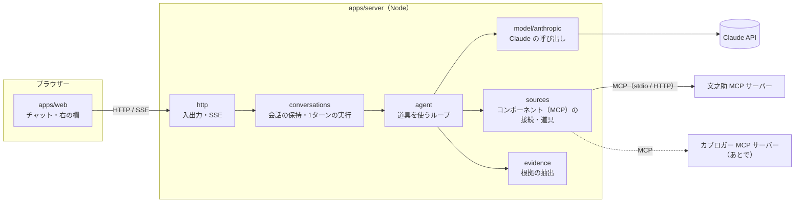
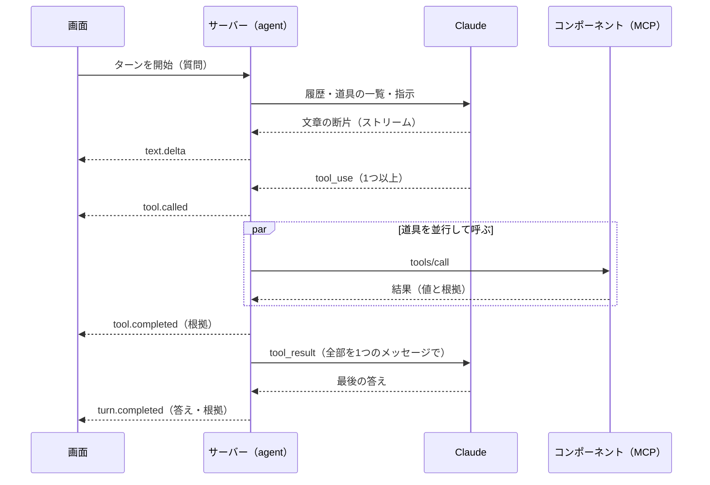

# Agorack の設計

Agorack は、異なるシステム（文之助：帳票、カブロガー：走行の記録 など）をツールという単位として扱い、 MCP で呼び分けて、利用者の質問に根拠付きで答えるAIチャットです。

決めた理由の詳細は [決めごとの記録](decisions/) にあります。

---

## 1. 目的と範囲

### 目的
利用者がチャットで質問すると、Agorack が回答に必要なツールをMCPサーバーを通じて呼び出します。

ツールは回答に必要なデータを Agorackに渡します。

Agorackは受け取ったデータを回答の根拠としてチャットのサイドバーに表示する。（書類のどの欄か、走行のどの区間か）

**最初のバージョンで作ったもの**

- チャットの画面（プロンプト入力・回答の表示・回答の停止・チャット履歴）
- 会話のループ（Claude の Messages API で利用するツールを選ばせ、ツールが保持するの処理をMCPで呼び、結果を返す）
- ツールとのの接続（設定ファイルに書いた MCP サーバーにつなぐ。現時点で文之助のみ）
- 根拠の表示（MCPサーバーが返したデータを、回答の根拠としてサイドバーに表示する。）
- ツール画面を埋め込む（サイドバーにツールがもつデータ表示用のコンポーネントを iframe で出す。最初は文之助の書類の画面。§7.4）

**最初の版で作らないもの**

- カブロガーの接続と走行の表示（カブロガーの MCP の仕様が決まってから）
- 会話の保存（最初はサーバーのメモリとブラウザーの中だけ）
- ログイン・利用者の区別（最初は手元の PC だけで動かす）
- 画像の受け取りとコンポーネントへの取込の依頼
- 文章のベクトル検索（RAG の索引）。値はコンポーネントの道具で欄の条件を指定して引く（[0007](decisions/0007-structured-tools-over-vector-search.md)）

---

## 2. 全体像



- ブラウザーは Agorack のサーバーだけと話す。Claude の API キーとコンポーネントへの接続はサーバーだけが持つ。
- サーバーはコンポーネントのコードを import しない。コンポーネントとは MCP だけでつながる。

---

## 3. 守る約束

1. **値を作らない**：答えに使う値は、コンポーネントの道具が返したものだけ。推測で埋めたり、言い換えたりしない。数の計算はコンポーネントの道具（例：文之助の `aggregate`）に任せる。
2. **根拠を必ず示す**：答えには、コンポーネントが返した根拠（どのコンポーネントの、どの書類・欄・区間か）を添える。
3. **値を直さない**：Agorack には修正・確定の操作を作らない。値が違いそうなときは、コンポーネントの画面（文之助の確認画面など）で確かめるよう案内する。
4. **コンポーネントの中に手を入れない**：コンポーネントとは MCP（将来はコンポーネントの外向け API）だけでつながる。コンポーネントの仕様に依存する処理を Agorack に書かない。
5. **コンポーネントが増えても Agorack の中心は変えない**：コンポーネントを足すのは設定と、根拠の表示（`kind` ごと）を足すことだけで済むようにする。

---

## 4. リポジトリの構成

npm workspaces の monorepo にする。画面・サーバー・共通の契約を分け、契約（型）だけを共有する。

```
agorack/
├─ apps/
│  ├─ web/                 画面（Vite + React + TypeScript）
│  └─ server/              サーバー（Node + TypeScript）
├─ packages/
│  └─ contracts/           画面とサーバーの共通の契約（HTTP の要求と応答・SSE のイベント・根拠の型）
├─ config/
│  └─ sources.example.json つなぐコンポーネント（MCP サーバー）の設定の見本
├─ docs/
│  ├─ architecture.md      この文書
│  └─ decisions/           決めごとの記録（1件1ファイル）
├─ .github/                Issue と PR のテンプレート
├─ package.json            workspaces・全体のスクリプト
├─ tsconfig.base.json      全体で共通の TypeScript の設定
└─ README.md
```

依存の向きは一方向にする。

```
apps/web     ─┐
              ├─> packages/contracts
apps/server  ─┘
```

`apps/web` と `apps/server` は互いを import しない。共有するのは `packages/contracts` だけ。

### 4.1 apps/server

```
apps/server/src/
├─ main.ts                  起動：設定を読み、各部分を組み立てて HTTP を開く（組み立てはここだけ）
├─ config/                  設定の読み込みと検証（環境変数・コンポーネントの設定ファイル）
├─ http/                    HTTP の道筋と SSE への変換。入出力の形を整えるだけで、判断はしない
├─ conversations/           会話の保持（履歴）と、1ターンの実行の窓口
├─ agent/                   道具を使うループ。下の2つの「ポート」だけに依存する
│  ├─ ports.ts              ModelClient（モデルを呼ぶ）・ToolCatalog（道具の一覧と呼び出し）
│  └─ loop.ts               ループ本体（回数の上限・停止・並行した道具の呼び出し）
├─ model/
│  └─ anthropic/            ModelClient の Claude 実装（SDK の型と Agorack の型の変換）
├─ sources/                 ToolCatalog の実装。コンポーネント（MCP サーバー）への接続・道具の一覧・呼び出し
│  └─ mcp/                  MCP クライアントの接続（stdio・Streamable HTTP）
└─ evidence/                道具の結果から根拠を取り出し、共通の形にそろえる
```

**責務の分け方**

| 部分 | 知っていること | 知らないこと |
|---|---|---|
| `http` | HTTP・SSE・契約の型 | Claude・MCP・コンポーネント |
| `conversations` | 会話の履歴・ターンの開始と停止 | HTTP・SDK |
| `agent` | ループの規則（いつ道具を呼び、いつ止めるか） | Claude の SDK・MCP の SDK・コンポーネントの中身 |
| `model/anthropic` | Claude の SDK | MCP・コンポーネント・HTTP |
| `sources` | MCP の SDK・コンポーネントの設定 | Claude・HTTP |
| `evidence` | 根拠の共通の形 | コンポーネントごとの中身（文之助の欄の仕組みなど） |

`agent` はポート（インターフェース）だけに依存するので、Claude や MCP を差し替えたり、試験用の偽物に替えたりしても、ループの規則は変わらない。

### 4.2 apps/web

```
apps/web/src/
├─ main.tsx                 起動
├─ app/                     画面全体の枠（レイアウト・上部バー）
├─ features/
│  ├─ chat/                 会話の表示・入力・停止・状態
│  │  ├─ components/        答えと、答えの下の根拠の一覧（押すと右の欄で開く）
│  │  ├─ state/             会話の状態（ターン・回答・根拠）
│  │  └─ api/               サーバーとの通信（ターンの開始・SSE の受け取り）
│  ├─ history/              会話の履歴（サイドバー）
│  ├─ sources/              コンポーネントの状態（上部バー）
│  └─ evidence/             右の欄（書類の欄）
│     ├─ EvidencePanel.tsx  外の枠（境目・幅のつまみ・開け閉め）と、選んだ根拠の表示（embedUrl・kind を見て表示を選ぶ）
│     ├─ selection.ts       どの根拠を選んでいるか（表の行・答えの下の根拠のホバー・クリックとつなぐ）
│     └─ renderers/
│        ├─ embed/          コンポーネントの埋め込み用の画面（iframe と postMessage のやり取り）
│        ├─ document/       書類（ページ画像に欄の枠を描く。埋め込めないときに使う）
│        └─ fallback/       知らない kind（ラベルと値だけを出す）
├─ shared/                  機能をまたいで使う部品（Markdown の表示・回る輪など）
└─ styles/
```

### 4.3 packages/contracts

```
packages/contracts/src/
├─ evidence.ts              根拠の共通の形
├─ events.ts                1ターンの SSE のイベント
├─ api.ts                   HTTP の要求と応答
├─ embed.ts                 コンポーネントの画面の埋め込み（住所と postMessage の形。§7.4）
└─ index.ts
```

型と、実行時に検証するスキーマ（zod）を同じ場所に置き、画面とサーバーの両方で同じ検証を使う。

---

## 5. 会話のループ



**ループの規則**（`agent/loop.ts`）

- `stop_reason` が `tool_use` の間は、道具を呼んで結果を返し、繰り返す。`end_turn` で終える。
- 1回の応答に道具の呼び出しが複数あれば、並行して呼び、結果は**1つの user メッセージ**にまとめて返す。
- 失敗した道具は落とさず、`is_error: true` の結果として返す（Claude が言い直しや利用者への確認を判断できるように）。
- 道具の入力は、MCP サーバーが公開しているスキーマで検証してから呼ぶ。合わなければ、呼ばずにエラーの結果を返す。
- 回数の上限（1ターンあたりの道具の呼び出しの回数）を設け、超えたら止めて利用者に伝える。
- 画面との接続が切れた・停止が押されたら、Claude への要求と道具の呼び出しを中断する。
- `stop_reason` が `refusal` や `max_tokens` のときは、道具を呼ばずに、その旨を利用者に伝える。

**Claude の呼び出し**（`model/anthropic`）

- 公式の SDK（`@anthropic-ai/sdk`）の `messages.stream` を使う。
- モデルと推論の深さ（effort）は設定で変えられるようにする。会話の応答は速さを優先して effort を低めにする。
- 道具の選び方は `auto`（特定の道具を強制しない）。
- モデルが安全上の理由で応答を断ったとき（`stop_reason: "refusal"`）に、別のモデルで続けるサーバー側の切り替え（`fallbacks`）を有効にする。切り替えても断られたときは、その旨を利用者に伝える。
- 道具の呼び出しは SDK の自動実行（Tool Runner）を使わず、`agent` のループで自分で回す。道具ごとに根拠を取り出して画面に流すためである。
- Messages API の MCP コネクター（Claude 側がコンポーネントを直接呼ぶ機能）は使わない。コンポーネントが手元の PC で動く標準入出力の MCP サーバーであることと、根拠の抽出を Agorack で行うためである。

**指示（system prompt）**

- Agorack の共通の指示（§3 の守る約束）。
- 各コンポーネントの MCP サーバーが公開する説明（`instructions`）を、コンポーネントの名前を付けて足す。

---

## 6. コンポーネント（MCP サーバー）の接続

### 6.1 設定

つなぐコンポーネントは設定ファイルに書く。手元の PC の場所を含むので、実物の `config/sources.json` は Git に入れず、見本の `config/sources.example.json` だけを入れる。

```json
{
  "sources": [
    {
      "id": "fuminosuke",
      "name": "文之助",
      "description": "帳票（台帳・申込書）の確定済みの値",
      "transport": {
        "type": "stdio",
        "command": "C:/path/to/fuminosuke/backend/.venv/Scripts/python.exe",
        "args": ["-m", "app.mcp_server"],
        "cwd": "C:/path/to/fuminosuke/backend",
        "env": {
          "FUMINOSUKE_API_URL": "http://127.0.0.1:8010",
          "FUMINOSUKE_WEB_URL": "http://127.0.0.1:5180"
        }
      },
      "embed": { "origin": "http://127.0.0.1:5180" }
    },
    {
      "id": "cub",
      "name": "カブロガー",
      "description": "走行の記録",
      "transport": { "type": "http", "url": "https://example.invalid/mcp" },
      "enabled": false
    }
  ]
}
```

- `transport.type` は `stdio`（手元で起動する）と `http`（Streamable HTTP の住所へつなぐ）の2種類。
- `id` は道具の名前の接頭辞になる（§6.2）。英数字と `_` だけ。
- `embed.origin` は、そのコンポーネントの埋め込み用の画面の住所（§7.4）。書かないコンポーネントは iframe で埋め込まない。文之助の MCP には、同じ住所を `FUMINOSUKE_WEB_URL` で渡す（埋め込み用の画面の住所 `/embed?job=…&field=…` を作るのに使う。ないと `embed_url` は null になる）。

### 6.2 道具の名前

コンポーネントをまたいで道具の名前が重ならないよう、Claude に渡す名前は `<コンポーネントのid>__<道具の名前>` にする（例：`fuminosuke__get_document`）。Claude が呼んだ名前から、どのコンポーネントのどの道具かを `sources` が引き戻す。

### 6.3 接続の状態

- 起動時に全部のコンポーネントへつなぎ、道具の一覧を取る。つなげないコンポーネントは「失敗」として記録し、残りのコンポーネントで動く。
- コンポーネントの状態（接続中・失敗とその理由・道具の数）は `GET /api/sources` で返し、画面に出す。
- 呼び出しの途中で接続が切れたら、その道具の結果をエラーとして返し、次のターンの前につなぎ直す。

---

## 7. 根拠

### 7.1 共通の形

コンポーネントが返す根拠の外枠をそろえる。中身（`location`）はコンポーネントごとに違ってよい。

```ts
type Evidence = {
  kind: string;            // 根拠の種類（例：document、ride）
  sourceId: string;        // どのコンポーネントか（設定の id）
  recordId: string;        // コンポーネントの中の記録の ID（書類ID・走行ID など）
  label: string;           // 人が読める説明（例：繁殖台帳1021「はじめ」の毛色）
  location: Record<string, unknown>; // コンポーネントごとの位置の情報
  value: unknown;          // 値
  embedUrl: string | null; // コンポーネントの埋め込み用の画面の絶対URL（埋め込めないときは null）
};
```

コンポーネントの MCP は `kind`・`source_id`・`label`・`location`・`value`・`embed_url` を返す（文之助の MCP は `embed_url` 以外はこの形。`embed_url` は埋め込みの段階で足す）。名前の対応は次のとおり。

| コンポーネントの MCP が返す名前 | Agorack の型 | 意味 |
|---|---|---|
| `kind` | `kind` | 根拠の種類 |
| `source_id` | `recordId` | コンポーネントの中の記録の ID（文之助なら書類 ID） |
| `label` | `label` | 人が読める説明 |
| `location` | `location` | コンポーネントごとの位置の情報 |
| `value` | `value` | 値 |
| `embed_url`（なくてもよい） | `embedUrl` | 埋め込み用の画面の住所。ないときは `null` にそろえる |
| （なし） | `sourceId` | どのコンポーネントか。Agorack が、どのコンポーネントの道具を呼んだかから付ける |

コンポーネントの `source_id` は「記録の出どころ」の意味で、Agorack の `sourceId`（コンポーネントの id）とは別物なので、取り込むときに `recordId` へ名前を変える。

### 7.2 取り出し方

`evidence` は、道具の結果の構造化データ（`structuredContent`）の中から、`kind`・`source_id`・`label`・`location` を持つ要素を探して取り出す。コンポーネントごとの決まり（文之助の欄の仕組みなど）は知らない。同じ根拠が何度も出たら1つにまとめる。

### 7.3 画面での表示

右の欄は「書類の欄」1枚にする（決定 0005）。

- 外の枠（枠線・角の丸み・チャットと一続きの境目・幅を変えるつまみ）は Agorack が描く。中には、選んだ根拠の表示を1つだけ置く。見出しや「文之助の画面」などの文字は置かない。
- 外の枠の padding は 0 にし、中の表示を枠いっぱいに置く。余白は中の表示が持つ。
- 境目のつまみはドラッグか ←/→ キーで動かし、チャットの割合を 25〜75%（最初は 50%）で変える。割合は画面の保存の領域に覚え、読めないときは最初の値に戻す。
- 900px 以下の幅では、文之助と同じく、チャットと右の欄を上下に半分ずつ積む（左のレールは残す）。
- 根拠の一覧は右の欄に置かず、答えの下に出す。一覧の根拠や、答えの表の行を押すと、その根拠を右の欄で開く。
- 右の欄は、答えに根拠があるとき自動で開く。コンポーネントの画面の ×（`embed:close`、§7.4）か、Agorack が描く表示（埋め込めないときの書類の表示など）の上の行の ×、Esc キーで閉じ、閉じるとチャットが広がる。表の行や答えの下の根拠を押すと開き直す。

中に置く表示は、次の順で選ぶ。

| 条件 | 表示 |
|---|---|
| `embedUrl` があり、その住所が埋め込みを許したコンポーネントのもの | コンポーネントの埋め込み用の画面を iframe で出す（§7.4） |
| `kind` が `document` | 書類のページ画像（`location.image_url`）に欄の枠（`location.box`）を描く |
| `kind` が `ride` | 地図に区間の線、グラフの時間帯を強調（カブロガーの接続とともに足す） |
| それ以外 | ラベルと値だけを出す |

iframe が開けない（コンポーネントが止まっている・書類が見つからない）ときは、`kind` ごとの表示に戻す。どの表示も同じ外の枠の中に置く。表示を足すのは `features/evidence/renderers/` の中だけで済むようにする。

### 7.4 コンポーネントの画面の埋め込み

コンポーネントは、根拠を1つ見せるための「埋め込み用の画面」を URL で公開する。Agorack はその画面を右の欄に iframe で出す。コンポーネントの画面を Agorack の React のビルドに取り込まないので、コンポーネントごとに別々に直せる。

**コンポーネントの側の約束**

- 埋め込み用の画面は見るだけにする。値の修正・確定の操作は出さない（§3 の「値を直さない」）。修正したいときのために、コンポーネントの普通の画面を別のタブで開くボタン（「コンポーネントで開く」）だけを置く。
- 埋め込み用の画面は、右の欄の「枠の中身」だけを描く。外の枠線・角の丸み・余白は描かない（Agorack が描く）。上の端に、閉じる × と、その左に「コンポーネントで開く」のアイコンのボタンを置く。
- `agorack:highlight` の `targetIds` があれば、その場所をまとめて強調し、`targetId` をさらに強くする。`targetIds` がなければ `targetId` だけを強調する。形の合わないメッセージは丸ごと捨てる。
- `Content-Security-Policy: frame-ancestors` で、設定に書いた住所（Agorack の画面）だけに埋め込みを許す。
- 根拠に `embed_url`（その根拠を見せる画面の絶対URL）を付けて返す。

**Agorack の側の約束**

- 外の枠は Agorack が描き、iframe は枠線なし（`border: 0`）で枠の中いっぱいに置く。
- 埋め込みを許す住所（origin）は、コンポーネントの設定（`config/sources.json` の `embed.origin`）に書き、`GET /api/sources` で画面に渡す。`embedUrl` の住所がこの一覧にないときは iframe を使わない。
- iframe には `sandbox="allow-scripts allow-same-origin allow-popups allow-popups-to-escape-sandbox"` だけを付ける。上の画面を動かす権限やフォームを送る権限は与えない。`allow-popups-to-escape-sandbox` は、「コンポーネントで開く」で開いたコンポーネントの普通の画面に sandbox の制限が引き継がれ、ダウンロードや確認の小窓が止まるのを防ぐため。
- 同じ記録の中で強調する場所だけが変わるときは、iframe を読み直さず `postMessage` で伝える。
- `agorack:highlight` は、`embed:ready` を受けたあとと、根拠や選んだ場所が替わったときに送る。`targetIds` には、この答えの根拠のうち、同じ記録の場所の ID を全部入れる（選んだ場所も含める）。
- Agorack の画面とコンポーネントの画面の住所は、どちらも `127.0.0.1` か、どちらも `localhost` にそろえる。片方だけ違うと、ブラウザーが別のサイトと見なし、埋め込んだ画面の保存領域や Cookie が使えないおそれがある。
- Agorack の画面は 5174 に固定し（Vite の `strictPort` で、空いていなければ起動を止める）、コンポーネントの画面と番号が入れ替わらないようにする。

**やり取り（postMessage）**

| 向き | メッセージ | 意味 |
|---|---|---|
| Agorack → コンポーネント | `{ type: "agorack:highlight", targetId, targetIds? }` | 強調する場所を替える。`targetId` は選んだ場所、`targetIds`（なくてもよい）は根拠の場所の全部。移すあいだは古い名前の `fieldId`・`fieldIds` にも同じ値を入れる（0006） |
| コンポーネント → Agorack | `{ type: "embed:ready" }` | 表示の準備ができた |
| コンポーネント → Agorack | `{ type: "embed:error", code }` | 記録が見つからない・表示できない |
| コンポーネント → Agorack | `{ type: "embed:close" }` | コンポーネントの画面の × が押された。Agorack は右の欄を閉じる |

`targetId` と `targetIds` の ID は 1〜200 文字の文字列、`targetIds` は 500 個まで。ID が何を指すか（書類の欄・走行の区間など）はコンポーネントが決め、Agorack は解釈しない。受け取る側は、相手の origin が許した住所であることを必ず確かめる。メッセージの形は `packages/contracts/src/embed.ts` に置き、zod で検証する。

---

## 8. 画面とサーバーの契約

### 8.1 HTTP

| メソッド | パス | 内容 |
|---|---|---|
| GET | `/api/health` | サーバーが動いているか |
| GET | `/api/sources` | コンポーネントの一覧と状態（接続中・失敗の理由・道具の数・埋め込みを許す住所） |
| POST | `/api/conversations` | 会話を始める。会話の ID を返す |
| POST | `/api/conversations/:id/turns` | 質問を送る。応答は SSE で流す |
| POST | `/api/conversations/:id/turns/current/stop` | 進行中のターンを止める |
| DELETE | `/api/conversations/:id` | 会話を消す |

### 8.2 1ターンの SSE のイベント

| イベント | 中身 | いつ |
|---|---|---|
| `turn.started` | ターンの ID | 始まったとき |
| `text.delta` | 文章の断片 | 答えの文章が届くたび |
| `tool.called` | 呼び出しの ID・コンポーネント・道具・入力 | 道具を呼ぶとき |
| `tool.completed` | 呼び出しの ID・成功か・根拠の一覧・要約 | 道具が返ったとき |
| `turn.completed` | 最後の答え・根拠の一覧・終わった理由 | 終わったとき |
| `turn.failed` | エラーのコードと文章 | 失敗・停止したとき |

画面は `tool.called` と `tool.completed` で「文之助で書類を探しています」などの進み具合を出し、`turn.completed` の根拠で、答えの下に根拠の一覧を出し、右の欄を開く。

---

## 9. 設定と秘密

| 項目 | 置き場所 | Git |
|---|---|---|
| Claude の API キー | `apps/server/.env`（`ANTHROPIC_API_KEY`） | 入れない（`.env.example` だけ入れる） |
| モデル・effort・ループの上限 | `apps/server/.env` | 入れない（見本は入れる） |
| つなぐコンポーネント | `config/sources.json` | 入れない（`sources.example.json` だけ入れる） |
| サーバーの住所 | `127.0.0.1` だけで待ち受ける（最初の版） | — |

画面からの要求は、開発時の画面の住所（Vite、`http://127.0.0.1:5174`）からだけ受け付ける。文之助の画面が 5173 を使うので、Agorack の画面は 5174 で開く。

---

## 10. 確かめ方

- 型の検査（`tsc`）と静的検査（ESLint）を、workspaces 全体で通す。
- `agent` のループは、偽の ModelClient と ToolCatalog で、道具の呼び出し・並行・エラー・回数の上限・停止を確かめる。
- `evidence` の取り出しは、文之助の MCP が実際に返した結果を保存したもので確かめる。
- 通しの確認は、文之助と文之助の MCP サーバーにつなぎ、帳票の質問（値・合計・最大・条件で探す）に根拠付きで答えること、右の欄で根拠の欄が強調されること、埋め込めないときにページ画像の表示に戻ることを確かめる。
- 画面は、サーバーができる前から、決まったイベントを流す偽のサーバーで作って確かめる。

---

## 11. 次の版で考えること

- カブロガーの接続と `ride` の表示
- ログインがあるコンポーネント（Cognito など）の画面を iframe で埋め込むときの、ログインの状態の受け渡し
- 会話の保存（データベース）
- コンポーネントの MCP を HTTP で公開したときの認証（機械用の鍵）
- 道具の結果が大きいときの扱い（Claude には要約だけを渡し、根拠の詳細は画面にだけ流す）
- 画像の受け取りとコンポーネントへの取込の依頼
- ログイン・利用者の区別
