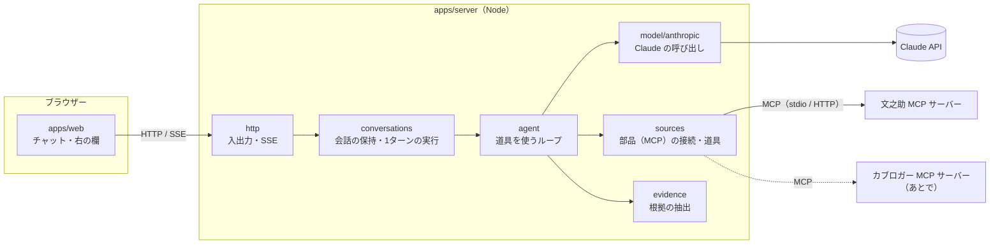
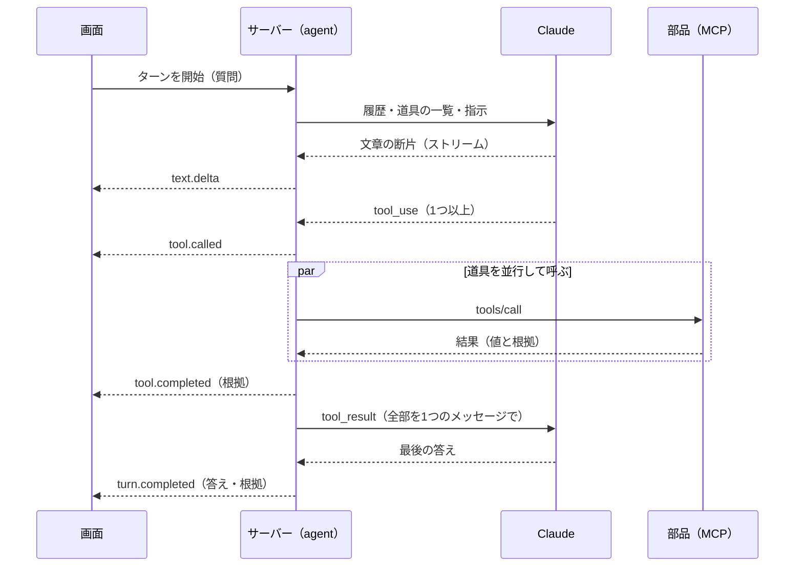

# Agorack の設計

Agorack は、業務の部品（文之助：帳票、カブロガー：走行の記録 など）を MCP で呼び分けて、利用者の質問に根拠付きで答えるチャットです。この文書は、最初の版の構成・責務の分け方・部品とのつなぎ方を決めます。

決めた理由の詳細は [決めごとの記録](decisions/) にあります。

---

## 1. 目的と範囲

**目的**：利用者がチャットで質問すると、Agorack が必要な部品の道具（MCP の tool）を選んで呼び、部品が返した値と根拠をもとに答える。画面の右の欄に、答えの根拠（書類のどの欄か、走行のどの区間か）を表示する。

**最初の版で作るもの**

- チャットの画面（会話・入力・回答の Markdown・停止・会話の履歴）
- 会話のループ（Claude の Messages API で道具を選ばせ、MCP で部品を呼び、結果を返して繰り返す）
- 部品の接続（設定ファイルに書いた MCP サーバーにつなぐ。最初は文之助だけ）
- 根拠の抽出と表示（部品が返した根拠を共通の形にそろえ、右の欄に出す。最初は書類だけ）
- 部品の画面の埋め込み（右の欄に、部品の「埋め込み用の画面」を iframe で出す。最初は文之助の書類の画面。§7.4）

最初の版は次の順で作る。iframe の埋め込みは、チャットと根拠の表示が通しで動いてから取りかかる。

1. 土台・サーバー・画面（ページ画像に枠を描く右の欄まで）を作り、通しで確かめる
2. 部品の埋め込み用の画面（文之助の側）と、右の欄の iframe（Agorack の側）を作る

**最初の版で作らないもの**

- カブロガーの接続と走行の表示（カブロガーの MCP の仕様が決まってから）
- 会話の保存（最初はサーバーのメモリとブラウザーの中だけ）
- ログイン・利用者の区別（最初は手元の PC だけで動かす）
- 画像の受け取りと部品への取込の依頼
- 文章のベクトル検索（RAG の索引）

---

## 2. 全体像



- ブラウザーは Agorack のサーバーだけと話す。Claude の API キーと部品への接続はサーバーだけが持つ。
- サーバーは部品のコードを import しない。部品とは MCP だけでつながる。

---

## 3. 守る約束

1. **値を作らない**：答えに使う値は、部品の道具が返したものだけ。推測で埋めたり、言い換えたりしない。数の計算は部品の道具（例：文之助の `aggregate`）に任せる。
2. **根拠を必ず示す**：答えには、部品が返した根拠（どの部品の、どの書類・欄・区間か）を添える。
3. **値を直さない**：Agorack には修正・確定の操作を作らない。値が違いそうなときは、部品の画面（文之助の確認画面など）で確かめるよう案内する。
4. **部品の中に手を入れない**：部品とは MCP（将来は部品の外向け API）だけでつながる。部品の仕様に依存する処理を Agorack に書かない。
5. **部品が増えても Agorack の中心は変えない**：部品を足すのは設定と、根拠の表示（`kind` ごと）を足すことだけで済むようにする。

---

## 4. リポジトリの構成

npm workspaces の monorepo にする。画面・サーバー・共通の契約を分け、契約（型）だけを共有する。

```
agorack/
├─ apps/
│  ├─ web/                 画面（Vite + React + TypeScript）
│  └─ server/              サーバー（Node + TypeScript）
├─ packages/
│  └─ contracts/           画面とサーバーの共通の契約（HTTP の要求と応答・SSE のイベント・根拠の型）
├─ config/
│  └─ sources.example.json つなぐ部品（MCP サーバー）の設定の見本
├─ docs/
│  ├─ architecture.md      この文書
│  └─ decisions/           決めごとの記録（1件1ファイル）
├─ .github/                Issue と PR のテンプレート
├─ package.json            workspaces・全体のスクリプト
├─ tsconfig.base.json      全体で共通の TypeScript の設定
└─ README.md
```

依存の向きは一方向にする。

```
apps/web     ─┐
              ├─> packages/contracts
apps/server  ─┘
```

`apps/web` と `apps/server` は互いを import しない。共有するのは `packages/contracts` だけ。

### 4.1 apps/server

```
apps/server/src/
├─ main.ts                  起動：設定を読み、各部分を組み立てて HTTP を開く（組み立てはここだけ）
├─ config/                  設定の読み込みと検証（環境変数・部品の設定ファイル）
├─ http/                    HTTP の道筋と SSE への変換。入出力の形を整えるだけで、判断はしない
├─ conversations/           会話の保持（履歴）と、1ターンの実行の窓口
├─ agent/                   道具を使うループ。下の2つの「ポート」だけに依存する
│  ├─ ports.ts              ModelClient（モデルを呼ぶ）・ToolCatalog（道具の一覧と呼び出し）
│  └─ loop.ts               ループ本体（回数の上限・停止・並行した道具の呼び出し）
├─ model/
│  └─ anthropic/            ModelClient の Claude 実装（SDK の型と Agorack の型の変換）
├─ sources/                 ToolCatalog の実装。部品（MCP サーバー）への接続・道具の一覧・呼び出し
│  └─ mcp/                  MCP クライアントの接続（stdio・Streamable HTTP）
└─ evidence/                道具の結果から根拠を取り出し、共通の形にそろえる
```

**責務の分け方**

| 部分 | 知っていること | 知らないこと |
|---|---|---|
| `http` | HTTP・SSE・契約の型 | Claude・MCP・部品 |
| `conversations` | 会話の履歴・ターンの開始と停止 | HTTP・SDK |
| `agent` | ループの規則（いつ道具を呼び、いつ止めるか） | Claude の SDK・MCP の SDK・部品の中身 |
| `model/anthropic` | Claude の SDK | MCP・部品・HTTP |
| `sources` | MCP の SDK・部品の設定 | Claude・HTTP |
| `evidence` | 根拠の共通の形 | 部品ごとの中身（文之助の欄の仕組みなど） |

`agent` はポート（インターフェース）だけに依存するので、Claude や MCP を差し替えたり、試験用の偽物に替えたりしても、ループの規則は変わらない。

### 4.2 apps/web

```
apps/web/src/
├─ main.tsx                 起動
├─ app/                     画面全体の枠（レイアウト・上部バー）
├─ features/
│  ├─ chat/                 会話の表示・入力・停止・状態
│  │  ├─ components/
│  │  ├─ state/             会話の状態（ターン・回答・根拠）
│  │  └─ api/               サーバーとの通信（ターンの開始・SSE の受け取り）
│  ├─ history/              会話の履歴（サイドバー）
│  ├─ sources/              部品の状態（上部バー）
│  └─ evidence/             右の欄
│     ├─ EvidencePanel.tsx  根拠の一覧と、選んだ根拠の表示（embedUrl・kind を見て表示を選ぶ）
│     ├─ selection.ts       どの根拠を選んでいるか（表の行のホバー・クリックとつなぐ）
│     └─ renderers/
│        ├─ embed/          部品の埋め込み用の画面（iframe と postMessage のやり取り）
│        ├─ document/       書類（ページ画像に欄の枠を描く。埋め込めないときに使う）
│        └─ fallback/       知らない kind（ラベルと値だけを出す）
├─ shared/                  機能をまたいで使う部品（Markdown の表示・回る輪など）
└─ styles/
```

チャットの画面は、文之助のチャット（`AskPage` まわり）から、会話・入力・Markdown・停止・履歴・表の行のホバーで根拠を強調する部分だけを移し、文之助に固有の処理（画像の読み取り・音声・読み取り状況・スマホの調整）は持ち込まない。

### 4.3 packages/contracts

```
packages/contracts/src/
├─ evidence.ts              根拠の共通の形
├─ events.ts                1ターンの SSE のイベント
├─ api.ts                   HTTP の要求と応答
└─ index.ts
```

型と、実行時に検証するスキーマ（zod）を同じ場所に置き、画面とサーバーの両方で同じ検証を使う。

---

## 5. 会話のループ



**ループの規則**（`agent/loop.ts`）

- `stop_reason` が `tool_use` の間は、道具を呼んで結果を返し、繰り返す。`end_turn` で終える。
- 1回の応答に道具の呼び出しが複数あれば、並行して呼び、結果は**1つの user メッセージ**にまとめて返す。
- 失敗した道具は落とさず、`is_error: true` の結果として返す（Claude が言い直しや利用者への確認を判断できるように）。
- 道具の入力は、MCP サーバーが公開しているスキーマで検証してから呼ぶ。合わなければ、呼ばずにエラーの結果を返す。
- 回数の上限（1ターンあたりの道具の呼び出しの回数）を設け、超えたら止めて利用者に伝える。
- 画面との接続が切れた・停止が押されたら、Claude への要求と道具の呼び出しを中断する。
- `stop_reason` が `refusal` や `max_tokens` のときは、道具を呼ばずに、その旨を利用者に伝える。

**Claude の呼び出し**（`model/anthropic`）

- 公式の SDK（`@anthropic-ai/sdk`）の `messages.stream` を使う。
- モデルと推論の深さ（effort）は設定で変えられるようにする。会話の応答は速さを優先して effort を低めにする。
- 道具の選び方は `auto`（特定の道具を強制しない）。
- モデルが安全上の理由で応答を断ったとき（`stop_reason: "refusal"`）に、別のモデルで続けるサーバー側の切り替え（`fallbacks`）を有効にする。切り替えても断られたときは、その旨を利用者に伝える。
- 道具の呼び出しは SDK の自動実行（Tool Runner）を使わず、`agent` のループで自分で回す。道具ごとに根拠を取り出して画面に流すためである。
- Messages API の MCP コネクター（Claude 側が部品を直接呼ぶ機能）は使わない。部品が手元の PC で動く標準入出力の MCP サーバーであることと、根拠の抽出を Agorack で行うためである。

**指示（system prompt）**

- Agorack の共通の指示（§3 の守る約束）。
- 各部品の MCP サーバーが公開する説明（`instructions`）を、部品の名前を付けて足す。

---

## 6. 部品（MCP サーバー）の接続

### 6.1 設定

つなぐ部品は設定ファイルに書く。手元の PC の場所を含むので、実物の `config/sources.json` は Git に入れず、見本の `config/sources.example.json` だけを入れる。

```json
{
  "sources": [
    {
      "id": "fuminosuke",
      "name": "文之助",
      "description": "帳票（台帳・申込書）の確定済みの値",
      "transport": {
        "type": "stdio",
        "command": "C:/path/to/fuminosuke/backend/.venv/Scripts/python.exe",
        "args": ["-m", "app.mcp_server"],
        "cwd": "C:/path/to/fuminosuke/backend",
        "env": { "FUMINOSUKE_API_URL": "http://127.0.0.1:8010" }
      },
      "embed": { "origin": "http://127.0.0.1:5173" }
    },
    {
      "id": "cub",
      "name": "カブロガー",
      "description": "走行の記録",
      "transport": { "type": "http", "url": "https://example.invalid/mcp" },
      "enabled": false
    }
  ]
}
```

- `transport.type` は `stdio`（手元で起動する）と `http`（Streamable HTTP の住所へつなぐ）の2種類。
- `id` は道具の名前の接頭辞になる（§6.2）。英数字と `_` だけ。
- `embed.origin` は、その部品の埋め込み用の画面の住所（§7.4）。書かない部品は iframe で埋め込まない。

### 6.2 道具の名前

部品をまたいで道具の名前が重ならないよう、Claude に渡す名前は `<部品のid>__<道具の名前>` にする（例：`fuminosuke__get_document`）。Claude が呼んだ名前から、どの部品のどの道具かを `sources` が引き戻す。

### 6.3 接続の状態

- 起動時に全部の部品へつなぎ、道具の一覧を取る。つなげない部品は「失敗」として記録し、残りの部品で動く。
- 部品の状態（接続中・失敗とその理由・道具の数）は `GET /api/sources` で返し、画面に出す。
- 呼び出しの途中で接続が切れたら、その道具の結果をエラーとして返し、次のターンの前につなぎ直す。

---

## 7. 根拠

### 7.1 共通の形

部品が返す根拠の外枠をそろえる。中身（`location`）は部品ごとに違ってよい。

```ts
type Evidence = {
  kind: string;            // 根拠の種類（例：document、ride）
  sourceId: string;        // どの部品か（設定の id）
  recordId: string;        // 部品の中の記録の ID（書類ID・走行ID など）
  label: string;           // 人が読める説明（例：繁殖台帳1021「はじめ」の毛色）
  location: Record<string, unknown>; // 部品ごとの位置の情報
  value: unknown;          // 値
  embedUrl: string | null; // 部品の埋め込み用の画面の絶対URL（埋め込めないときは null）
};
```

部品の MCP は `kind`・`source_id`・`label`・`location`・`value`・`embed_url` を返す（文之助の MCP は `embed_url` 以外はこの形。`embed_url` は埋め込みの段階で足す）。名前の対応は次のとおり。

| 部品の MCP が返す名前 | Agorack の型 | 意味 |
|---|---|---|
| `kind` | `kind` | 根拠の種類 |
| `source_id` | `recordId` | 部品の中の記録の ID（文之助なら書類 ID） |
| `label` | `label` | 人が読める説明 |
| `location` | `location` | 部品ごとの位置の情報 |
| `value` | `value` | 値 |
| `embed_url`（なくてもよい） | `embedUrl` | 埋め込み用の画面の住所。ないときは `null` にそろえる |
| （なし） | `sourceId` | どの部品か。Agorack が、どの部品の道具を呼んだかから付ける |

部品の `source_id` は「記録の出どころ」の意味で、Agorack の `sourceId`（部品の id）とは別物なので、取り込むときに `recordId` へ名前を変える。

### 7.2 取り出し方

`evidence` は、道具の結果の構造化データ（`structuredContent`）の中から、`kind`・`source_id`・`label`・`location` を持つ要素を探して取り出す。部品ごとの決まり（文之助の欄の仕組みなど）は知らない。同じ根拠が何度も出たら1つにまとめる。

### 7.3 画面での表示

右の欄は、根拠の一覧と、選んだ根拠の表示からなる。表示は次の順で選ぶ。

| 条件 | 表示 | 最初の版 |
|---|---|---|
| `embedUrl` があり、その住所が埋め込みを許した部品のもの | 部品の埋め込み用の画面を iframe で出す（§7.4） | 作る（最後の段階） |
| `kind` が `document` | 書類のページ画像（`location.image_url`）に欄の枠（`location.box`）を描く | 作る |
| `kind` が `ride` | 地図に区間の線、グラフの時間帯を強調 | あとで（カブロガーの仕様が決まってから） |
| それ以外 | ラベルと値だけを出す | 作る |

iframe が開けない（部品が止まっている・書類が見つからない）ときは、`kind` ごとの表示に戻す。表示を足すのは `features/evidence/renderers/` の中だけで済むようにする。

### 7.4 部品の画面の埋め込み

部品は、根拠を1つ見せるための「埋め込み用の画面」を URL で公開する。Agorack はその画面を右の欄に iframe で出す。部品の画面を Agorack の React のビルドに取り込まないので、部品ごとに別々に直せる。

**部品の側の約束**

- 埋め込み用の画面は見るだけにする。値の修正・確定の操作は出さない（§3 の「値を直さない」）。修正したいときのために、部品の普通の画面を別のタブで開くリンクだけを置く。
- `Content-Security-Policy: frame-ancestors` で、設定に書いた住所（Agorack の画面）だけに埋め込みを許す。
- 根拠に `embed_url`（その根拠を見せる画面の絶対URL）を付けて返す。

**Agorack の側の約束**

- 埋め込みを許す住所（origin）は、部品の設定（`config/sources.json` の `embed.origin`）に書き、`GET /api/sources` で画面に渡す。`embedUrl` の住所がこの一覧にないときは iframe を使わない。
- iframe には `sandbox="allow-scripts allow-same-origin allow-popups"` だけを付ける。上の画面を動かす権限やフォームを送る権限は与えない。
- 同じ記録の中で強調する場所だけが変わるときは、iframe を読み直さず `postMessage` で伝える。

**やり取り（postMessage）**

| 向き | メッセージ | 意味 |
|---|---|---|
| Agorack → 部品 | `{ type: "agorack:highlight", fieldId }` | 強調する場所を替える |
| 部品 → Agorack | `{ type: "embed:ready" }` | 表示の準備ができた |
| 部品 → Agorack | `{ type: "embed:error", code }` | 記録が見つからない・表示できない |

受け取る側は、相手の origin が許した住所であることを必ず確かめる。メッセージの形は `packages/contracts` に置き、zod で検証する。

---

## 8. 画面とサーバーの契約

### 8.1 HTTP

| メソッド | パス | 内容 |
|---|---|---|
| GET | `/api/health` | サーバーが動いているか |
| GET | `/api/sources` | 部品の一覧と状態（接続中・失敗の理由・道具の数・埋め込みを許す住所） |
| POST | `/api/conversations` | 会話を始める。会話の ID を返す |
| POST | `/api/conversations/:id/turns` | 質問を送る。応答は SSE で流す |
| POST | `/api/conversations/:id/turns/current/stop` | 進行中のターンを止める |
| DELETE | `/api/conversations/:id` | 会話を消す |

### 8.2 1ターンの SSE のイベント

| イベント | 中身 | いつ |
|---|---|---|
| `turn.started` | ターンの ID | 始まったとき |
| `text.delta` | 文章の断片 | 答えの文章が届くたび |
| `tool.called` | 呼び出しの ID・部品・道具・入力 | 道具を呼ぶとき |
| `tool.completed` | 呼び出しの ID・成功か・根拠の一覧・要約 | 道具が返ったとき |
| `turn.completed` | 最後の答え・根拠の一覧・終わった理由 | 終わったとき |
| `turn.failed` | エラーのコードと文章 | 失敗・停止したとき |

画面は `tool.called` と `tool.completed` で「文之助で書類を探しています」などの進み具合を出し、`turn.completed` の根拠で右の欄を出す。

---

## 9. 設定と秘密

| 項目 | 置き場所 | Git |
|---|---|---|
| Claude の API キー | `apps/server/.env`（`ANTHROPIC_API_KEY`） | 入れない（`.env.example` だけ入れる） |
| モデル・effort・ループの上限 | `apps/server/.env` | 入れない（見本は入れる） |
| つなぐ部品 | `config/sources.json` | 入れない（`sources.example.json` だけ入れる） |
| サーバーの住所 | `127.0.0.1` だけで待ち受ける（最初の版） | — |

画面からの要求は、開発時の画面の住所（Vite、`http://127.0.0.1:5174`）からだけ受け付ける。文之助の画面が 5173 を使うので、Agorack の画面は 5174 で開く。

---

## 10. 確かめ方

- 型の検査（`tsc`）と静的検査（ESLint）を、workspaces 全体で通す。
- `agent` のループは、偽の ModelClient と ToolCatalog で、道具の呼び出し・並行・エラー・回数の上限・停止を確かめる。
- `evidence` の取り出しは、文之助の MCP が実際に返した結果を保存したもので確かめる。
- 通しの確認は、手元の文之助（8010）と文之助の MCP サーバーにつなぎ、帳票の質問（値・合計・最大・条件で探す）に根拠付きで答え、右の欄に枠が出ることを確かめる。Claude の API を使うので、回数を記録する。
- 埋め込みの段階では、右の欄に文之助の埋め込み用の画面が出ること、根拠を替えると強調する欄が替わること、文之助を止めるとページ画像の表示に戻ることを確かめる。
- 画面は、サーバーができる前から、決まったイベントを流す偽のサーバーで作って確かめる。

---

## 11. 次の版で考えること

- カブロガーの接続と `ride` の表示
- ログインがある部品（Cognito など）の画面を iframe で埋め込むときの、ログインの状態の受け渡し
- 会話の保存（データベース）
- 部品の MCP を HTTP で公開したときの認証（機械用の鍵）
- 道具の結果が大きいときの扱い（Claude には要約だけを渡し、根拠の詳細は画面にだけ流す）
- 画像の受け取りと部品への取込の依頼
- ログイン・利用者の区別
